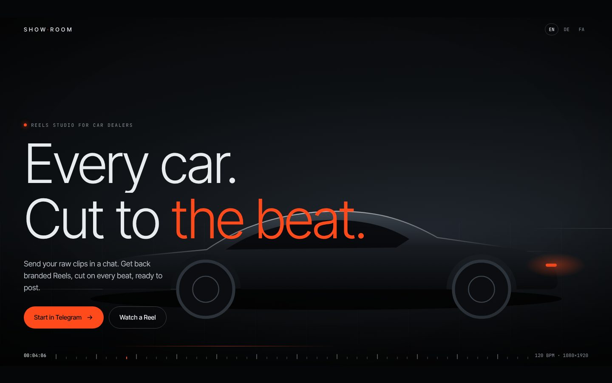
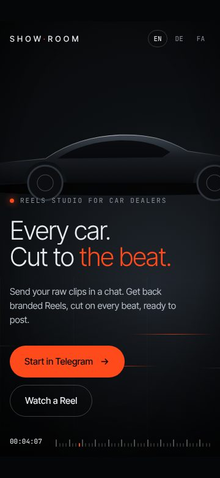
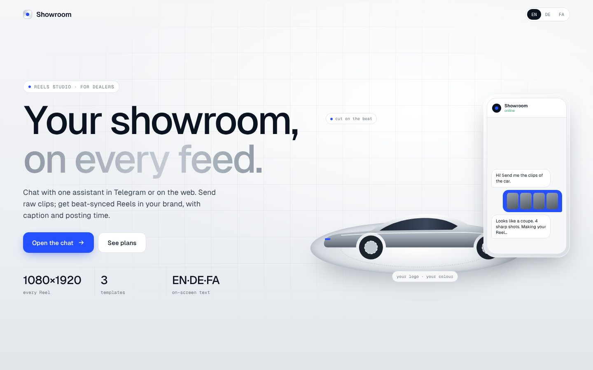
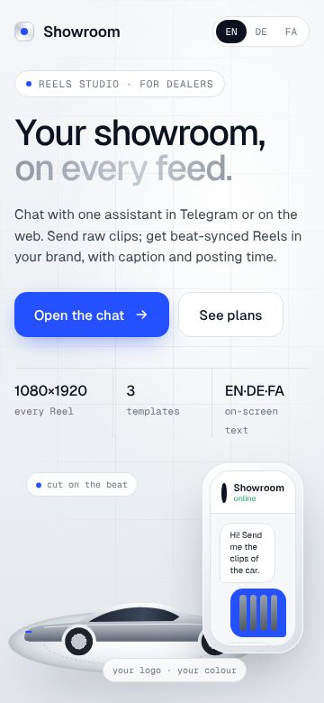
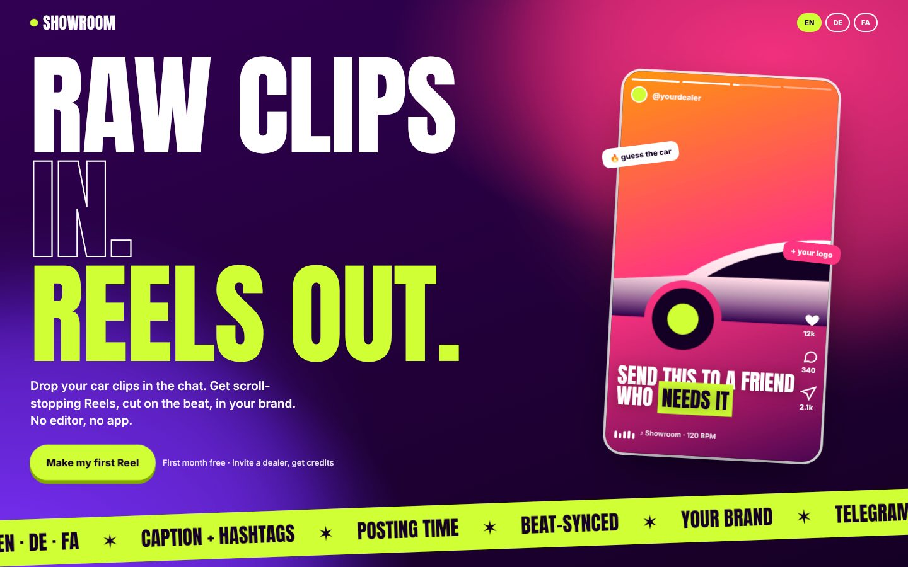
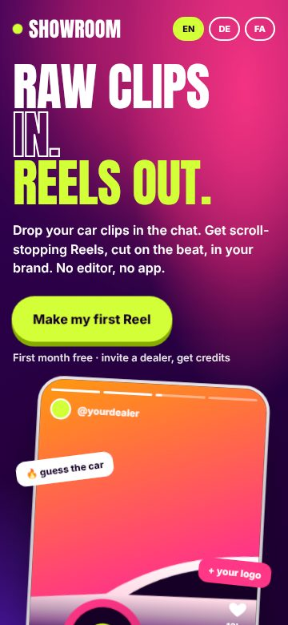

# طراحی تازه‌ی سایت «Showroom»: لطفاً یکی را انتخاب کنید (A، B یا C)

سلام. طبق نظر شما، طرح قبلی (کرم و مشکی و طلایی، «Beatlot») کامل کنار گذاشته شد. هیچ رنگ و فونت و حسی از آن طرح در این سه پیشنهاد نیست. اسم محصول هم حالا **Showroom** است.

برای اینکه قبل از ساختن کل سایت مطمئن شویم مسیر درست است، فقط **بخش اول صفحه** (همان چیزی که مشتری اول از همه می‌بیند) را به سه شکل کاملاً متفاوت ساختیم. هر سه واقعاً کد شده‌اند، حرکت دارند، روی گوشی درست نمایش داده می‌شوند و سه زبان انگلیسی، آلمانی و فارسی دارند (دکمه‌ی EN / DE / FA بالای صفحه).

عکس و فیلم ماشین‌ها فعلاً **نمونه** است (شکل ساده‌ی یک ماشین). فیلم‌های واقعی را بعداً جایگزین می‌کنیم؛ پس لطفاً به **حس و رنگ و چیدمان** نگاه کنید، نه به خود ماشین.

---

## A: «شب» (سینمایی و تیره)

- کل صفحه مثل یک فیلم است: زمینه‌ی گرافیتی و مشکی، نور که روی بدنه‌ی ماشین می‌لغزد، خط‌های نور جاده، نوار سیاه بالا و پایین مثل سینما.
- فقط **یک رنگ** تند دارد: نارنجیِ قرمز، فقط برای دکمه و ضرب‌ها.
- نوشته‌ها بزرگ ولی آرام: «Every car. Cut to the beat.» (هر ماشین، روی ضرب آهنگ).
- پایین صفحه یک نوار زمان و ضرب‌ها هست که با آهنگ ۱۲۰ ضرب در دقیقه جلو می‌رود.
- حس: لوکس، جدی، گران. شبیه سایت‌های Lucid و Pagani.
- مناسب برای: نمایشگاه‌هایی که ماشین گران و خاص می‌فروشند.

روی گوشی:  فارسی: 

## B: «استودیوی سفید» (روشن و مدرن)

- زمینه‌ی سفید و نقره‌ای، مثل یک نمایشگاه تمیز و نورانی. ماشین روی یک صفحه‌ی گردان ایستاده و تصویرش روی زمین می‌افتد.
- کنار ماشین یک گوشی هست که **خود سرویس را نشان می‌دهد**: دستیار می‌گوید «کلیپ‌ها را بفرست»، کلیپ‌ها می‌رسند، و ریلز آماده تحویل داده می‌شود. این گفت‌وگو مدام تکرار می‌شود.
- رنگ اصلی: آبی پررنگ، فقط برای دکمه.
- زیر دکمه‌ها سه عدد کوتاه: اندازه‌ی ریلز، تعداد قالب‌ها، سه زبان.
- حس: دقیق، قابل اعتماد، فنی. شبیه سایت Polestar و Porsche.
- مناسب برای: اینکه مشتری در چند ثانیه بفهمد سرویس **چطور کار می‌کند**.

روی گوشی:  فارسی: 

## C: «دراپ» (پرانرژی، حال‌وهوای اینستاگرام)

- رنگ‌های تند: صورتی، بنفش و سبزِ فسفری. نوشته‌های خیلی بزرگ: «Raw clips in. Reels out.» (کلیپ خام بفرست، ریلز بگیر).
- کنارش یک **ریلز واقعی‌نما** هست: هر چهار ضرب یک برش، نوارهای بالای استوری پر می‌شوند، روی «دراپ» آهنگ صفحه یک لحظه برق می‌زند.
- برچسب‌هایی مثل «ماشین را حدس بزن» و «+ لوگوی تو»، و یک نوار متحرک پایین صفحه با ویژگی‌ها.
- دکمه و نقطه‌ی لوگو با ضرب آهنگ می‌تپند.
- حس: جوان، شلوغ، دقیقاً مثل خود اینستاگرام.
- مناسب برای: نمایشگاه‌هایی که خودشان در اینستاگرام فعال‌اند و ویدیوی پرهیجان می‌خواهند.

روی گوشی:  فارسی: 

---

## نظر ما (اگر بخواهید)
- اگر می‌خواهید سایت **لوکس و متفاوت** دیده شود: **A**.
- اگر می‌خواهید مشتری **سریع بفهمد سرویس چیست**: **B**.
- اگر مشتری‌های شما بیشتر **جوان و اینستاگرامی** هستند: **C**.

می‌شود ترکیب هم کرد، مثلاً «رنگ‌های A ولی گوشیِ گفت‌وگوی B». فقط بنویسید.

## لطفاً جواب بدهید
فقط یکی از این‌ها را بنویسید:

- **A**
- **B**
- **C**
- یا ترکیب، مثلاً «A ولی با گوشی B»

بعد از انتخاب شما، بقیه‌ی سایت (قیمت‌ها، نحوه‌ی کار، نمونه ریلزها، دعوت دوستان، سؤال‌های رایج) را با همان طرح می‌سازیم و فیلم‌های واقعی ماشین را جای نمونه‌ها می‌گذاریم.

---

برای دیدن زنده: فایل‌های `hero-a.html`، `hero-b.html` و `hero-c.html` را در مرورگر باز کنید (حرکت‌ها فقط آنجا دیده می‌شوند). منابع و سایت‌هایی که بررسی کردیم در `research.md` هست.
